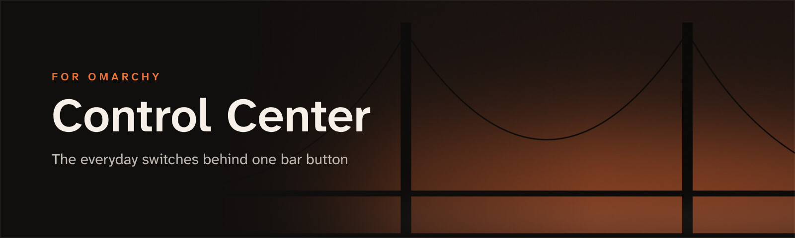
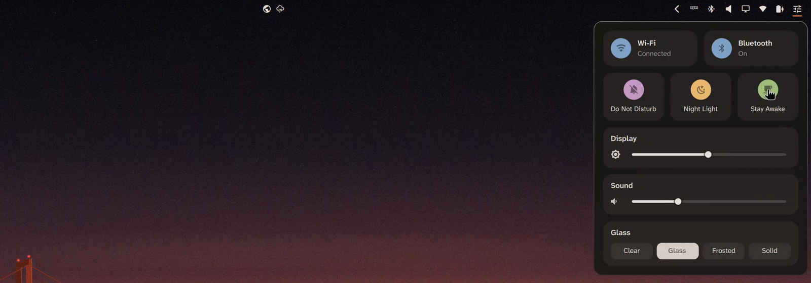

<p align="center">
  
</p>

<p align="center">
  <b>The everyday switches behind one bar button, for <a href="https://omarchy.org">Omarchy</a>.</b><br>
  Wi-Fi · Bluetooth · Do Not Disturb · Night Light · Stay Awake · brightness · volume · glass level
</p>

<p align="center">
  
  
  
</p>

<p align="center">
  <a href="#get-started">Get started</a> ·
  <a href="#whats-in-the-panel">What's in the panel</a> ·
  <a href="#glass-level-optional">Glass level</a> ·
  <a href="#configure">Configure</a> ·
  <a href="docs/commands.md">Commands</a>
</p>

<p align="center">
  
</p>

## Get started

**1. Install the plugin.** It adds a button to the bar and loads with the Omarchy shell.

```bash
omarchy plugin add https://github.com/JeoCrypto/omarchy-control-center --enable
```

**2. Give it a key** (optional) in `~/.config/hypr/bindings.lua`:

```lua
o.bind("SUPER + U", "Control Center", { panel = "io.github.jeocrypto.control-center" })
```

Click the button, or press the key, to open the panel. `Esc` closes it.

## What's in the panel

<table>
  <tr>
    <td width="50%" valign="top">
      <h3>📶 Wi-Fi and Bluetooth</h3>
      One click switches each on or off. The Wi-Fi tile shows the network you're on.
    </td>
    <td width="50%" valign="top">
      <h3>🌙 Three modes</h3>
      Do Not Disturb, Night Light and Stay Awake. They use Omarchy's own toggles, so the bar indicators and the Omarchy menu stay in step.
    </td>
  </tr>
  <tr>
    <td valign="top">
      <h3>🔆 Brightness and volume</h3>
      Two sliders. Click the speaker to mute. The brightness slider only appears when the display has a backlight Omarchy can control.
    </td>
    <td valign="top">
      <h3>🪟 Glass level</h3>
      Four steps from clear to solid for the bar, menus, popups and dock together. This row is optional and appears once <code>glass-level</code> is installed (below).
    </td>
  </tr>
  <tr>
    <td valign="top">
      <h3>🎨 Colour only where it means something</h3>
      The bar icon and idle controls are monochrome. A control that is switched on gets a soft tint taken from your theme: blue for Wi-Fi and Bluetooth, magenta for Do Not Disturb, yellow for Night Light, green for Stay Awake.
    </td>
    <td valign="top">
      <h3>🌍 Speaks your language</h3>
      Follows the language set in Omarchy, live. English and Portuguese ship today; other languages fall back to English. A translation is one small JSON file in <code>i18n/</code>, and pull requests are welcome.
    </td>
  </tr>
</table>

<p align="center">
  
</p>

## Glass level (optional)

`glass-level` is a small command that sets how see-through the desktop is, in one place: the bar, menus, popups, notifications and [Glass Dock](https://github.com/JeoCrypto/omarchy-glass-dock) change together, along with the blur strength.

| Level | Bar and menus | Blur | Terminals and file manager |
|---|---|---|---|
| `clear` | most see-through | light | slightly see-through |
| `glass` | Omarchy's usual frosted look | medium | solid |
| `frosted` | less see-through | heavy | solid |
| `solid` | opaque | off | solid |

It also gives windows, menus and popups a glass edge: a hairline border that is brightest along the top and fades towards the bottom. The focused window keeps your theme's accent colour.

**Install it** from the plugin folder. These three steps are the whole installation, and each is something you do yourself; the plugin never edits your Hyprland config.

```bash
cd ~/.config/omarchy/plugins/io.github.jeocrypto.control-center
install -Dm755 extras/glass-level ~/.local/bin/glass-level
install -Dm644 extras/glass.lua ~/.config/hypr/glass.lua
```

Then add one line at the end of `~/.config/hypr/looknfeel.lua`:

```lua
dofile(os.getenv("HOME") .. "/.config/hypr/glass.lua")
```

Run `glass-level glass` once. The Glass row now shows in Control Center. For a key that steps through the levels:

```lua
o.bind("SUPER + CTRL + G", "Cycle glass level", "glass-level next")
```

What it changes, and how to undo it, is in [docs/glass-level.md](docs/glass-level.md).

## Configure

**Hide the network name.** If you share your screen, the Wi-Fi tile can say "Connected" instead of the network's name:

```bash
omarchy bar set io.github.jeocrypto.control-center showNetworkName false
```

**Move the button.** It's a normal bar widget:

```bash
omarchy bar move io.github.jeocrypto.control-center --after omarchy.power
```

**Script it.** The panel is a thin view over one script, so everything it does is also a command. See [docs/commands.md](docs/commands.md).

```bash
~/.config/omarchy/plugins/io.github.jeocrypto.control-center/bin/control-center status
omarchy-shell shell toggle io.github.jeocrypto.control-center
```

## Update and remove

```bash
omarchy plugin update io.github.jeocrypto.control-center
omarchy restart shell
```

Restart the shell to load a new version.

```bash
omarchy plugin remove io.github.jeocrypto.control-center
```

If you installed glass level, [docs/glass-level.md](docs/glass-level.md#remove) lists the three things to take out.

## Development

```bash
python3 -m unittest discover -s tests -v
```

Tests cover the helper runner (one report per run, including a helper that cannot be started or overruns, no processes left behind, and a cleanup that fails reported as a failure) and `glass-level` (existing tables, the block from earlier versions, invalid files, interrupted and concurrent updates, a failure or a kill between its two files, permissions and symlinks). The Quickshell cases run in a throwaway Quickshell instance and are skipped without Quickshell and a Wayland session. `glass-level` is tested against a temporary home folder; your settings are not touched.

## Requirements

- Omarchy 4 (Hyprland 0.55+ with Lua config, Quickshell 0.3+)
- `nmcli`, `brightnessctl`, `wpctl` and `jq`, which Omarchy includes
- Glass level (optional): Python 3.11 or newer, which Omarchy includes

Built and tested on Omarchy 4.5.0 on a laptop with one display.

---

<p align="center">
  <b>Part of the Golden Gate set for Omarchy</b><br>
  <a href="https://github.com/JeoCrypto/omarchy-golden-gate-theme">Golden Gate theme</a> ·
  <a href="https://github.com/JeoCrypto/omarchy-glass-dock">Glass Dock</a> ·
  <a href="https://github.com/JeoCrypto/omarchy-control-center">Control Center</a> ·
  <a href="https://github.com/JeoCrypto/omarchy-spotlight-apps">Spotlight Apps</a> ·
  <a href="https://github.com/JeoCrypto/omarchy-snap-layouts">Snap Layouts</a>
</p>

<p align="center"><sub>Contributed by <a href="https://vgsi.pt">VGSI</a> · MIT licence</sub></p>
